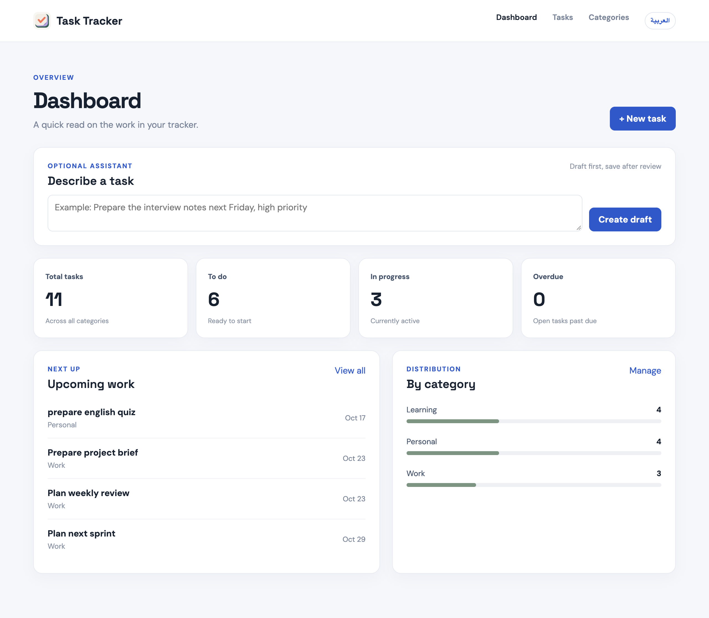
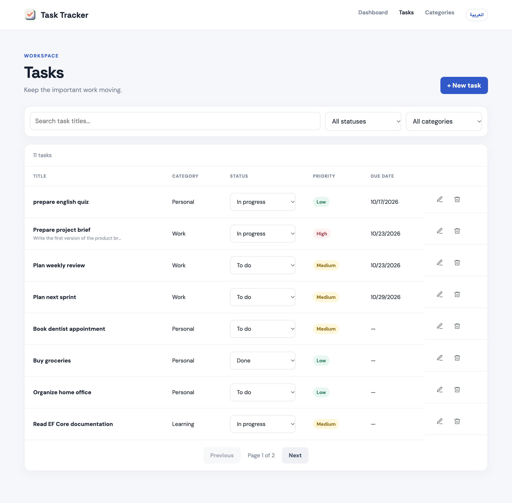
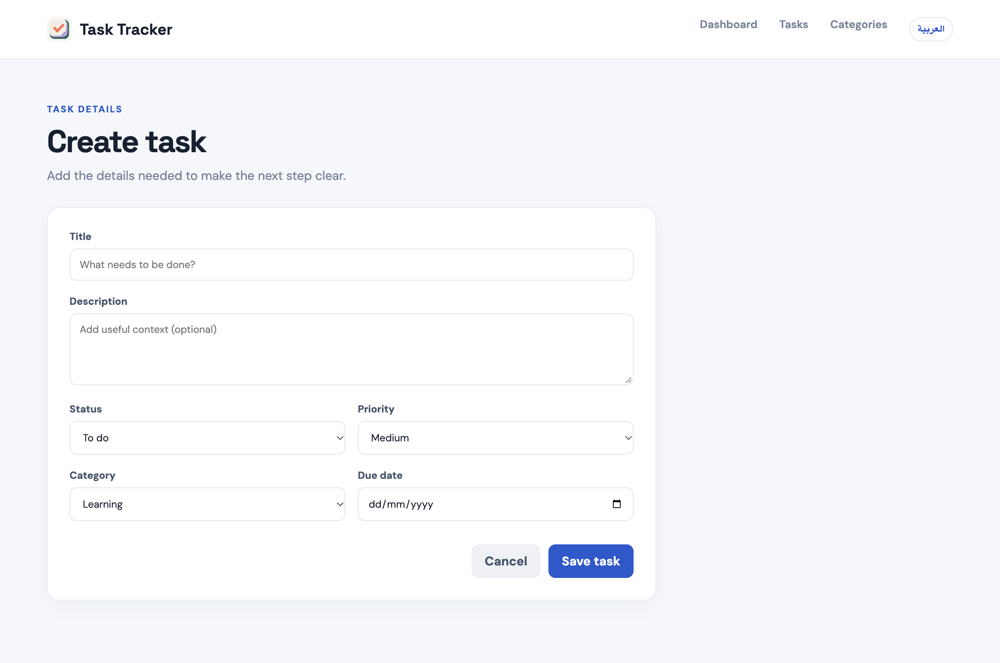
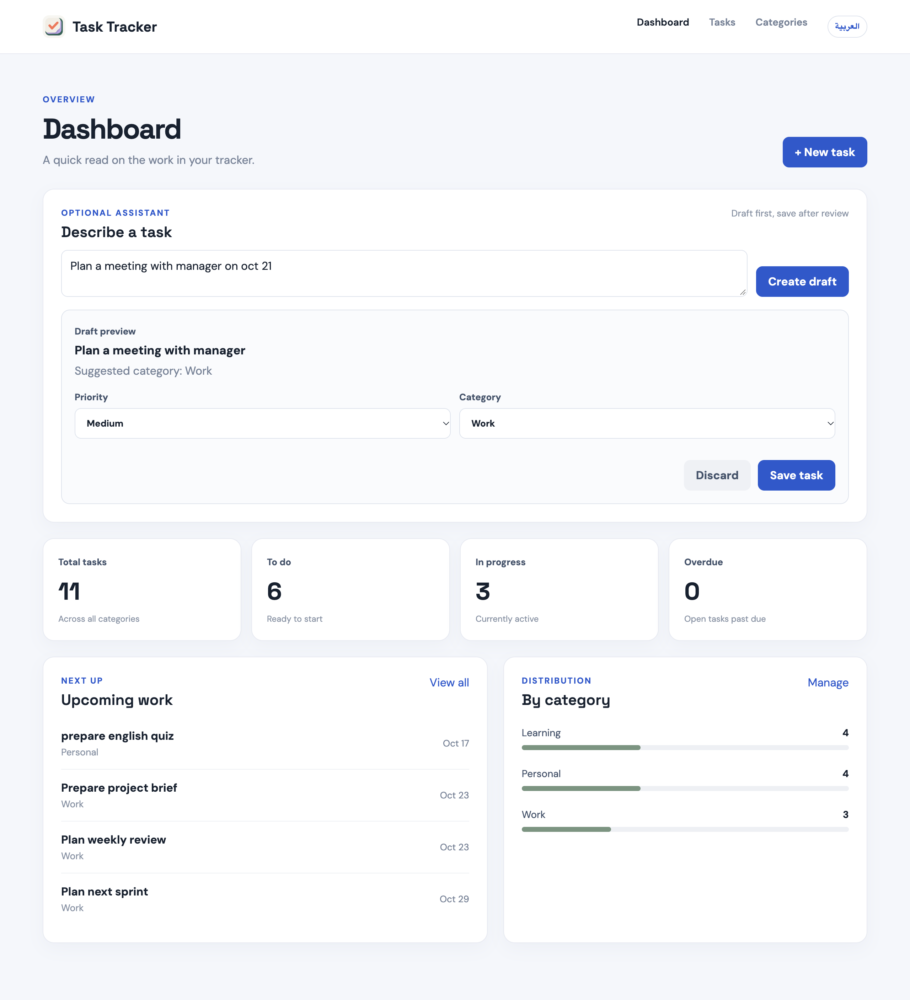
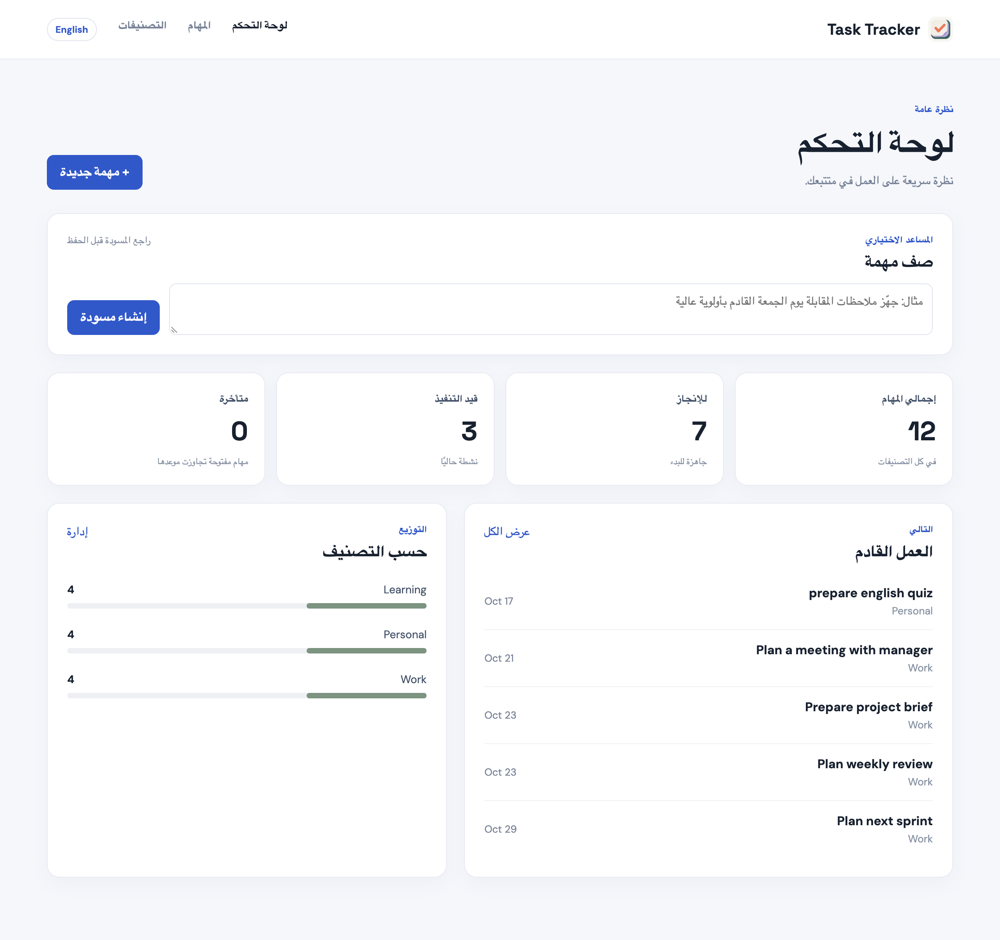

# Task Tracker

Task Tracker is a focused workspace for organizing tasks, monitoring progress, and turning natural-language requests into reviewable task drafts. It is built as a full-stack application with a Vue frontend, an ASP.NET Core API, Entity Framework Core, and SQLite persistence.

## Highlights

- Searchable and filterable task list with pagination
- Task creation, editing, deletion, and quick status updates
- Categories with task counts
- Dashboard summaries for status, priority, upcoming work, and overdue tasks
- Optional AI-assisted task drafting with review before saving
- English and Arabic interface with full RTL layout support
- API validation, consistent error responses, and OpenAPI documentation

## Technology

- Vue 3 with the Composition API and Vite
- ASP.NET Core Web API on .NET 10
- Entity Framework Core with migrations
- SQLite for straightforward local persistence
- Axios for frontend API communication
- Docker Compose for repeatable local startup

## Requirements

For local development, install:

- .NET SDK 10 or later
- Node.js 20 or later
- npm 10 or later

Docker Desktop is required only if you want to run the containerized stack.

## Run with Docker

From the repository root:

```bash
docker compose up --build
```

Then open [http://localhost:5173](http://localhost:5173).

The frontend is served by its container and forwards `/api` requests to the API container. The API initializes the database schema and seed data on startup. The database is stored in a named Docker volume so it survives normal container restarts.

Run in the background:

```bash
docker compose up --build -d
```

Stop the stack:

```bash
docker compose down
```

Remove the persistent Docker database only when intentionally resetting local data:

```bash
docker compose down -v
```

## Run locally

Start the API:

```bash
cd backend/TaskTracker.Api
dotnet restore
dotnet run
```

The API runs at `http://localhost:5172`. OpenAPI is available at `http://localhost:5172/openapi/v1.json` while the API is running.

In a second terminal, start the frontend:

```bash
cd frontend
npm install
cp .env.example .env
npm run dev
```

The frontend normally runs at `http://localhost:5173`.

## Database and migrations

The API applies pending Entity Framework Core migrations and seed data when it starts. To manage migrations manually from the API project directory:

```bash
cd backend/TaskTracker.Api
dotnet ef database update
```

To create a new migration after changing the data model:

```bash
dotnet ef migrations add MigrationName
dotnet ef database update
```

The initial migration creates the schema, three categories, and the sample tasks used by the application.

## Configuration

The frontend API URL is configured through `frontend/.env`:

```env
VITE_API_BASE_URL=http://localhost:5172/api
```

The optional assistant is configured through a root `.env` file. Start from the template:

```bash
cp .env.example .env
```

Then add your own key locally. Environment files containing secrets are ignored by Git and must never be committed.

## Optional assistant

The dashboard assistant converts a natural-language request into a suggested task draft. The draft includes a title, priority, due date, and category where available. The user can review and adjust the suggestion before saving it through the normal task workflow.

The assistant uses structured output and server-side normalization. Invalid, incomplete, or unavailable assistant responses are handled as controlled errors, so the main task tracker remains usable.

The endpoint is:

```text
POST /api/tasks/ai-suggest
```

## Architecture

The application keeps responsibilities separated:

- `backend/TaskTracker.Api/Controllers` handles HTTP routes and response codes.
- `backend/TaskTracker.Api/DTOs` defines request and response contracts.
- `backend/TaskTracker.Api/Services` contains business and persistence operations.
- `backend/TaskTracker.Api/Data` configures Entity Framework Core and seed data.
- `backend/TaskTracker.Api/Entities` contains the persistence model and enums.
- `frontend/src/views` contains the main screens.
- `frontend/src/services/api.js` is the frontend HTTP integration point.
- `frontend/src/i18n.js` manages translations and document direction.

Controllers were chosen because the API has several related resources, request models, validation rules, and service dependencies. The explicit structure keeps routing, business logic, and persistence easy to review.

## API behavior

The API follows conventional resource-oriented behavior:

- `GET` reads tasks and categories.
- `POST` creates resources and returns their location.
- `PUT` replaces a task.
- `PATCH` changes only a task's status.
- `DELETE` removes a task.

Requests are validated at the API boundary, missing resources return `404`, duplicate category names return `409`, and unexpected failures are converted into clean JSON error responses.

## Testing and verification

Run the backend test suite:

```bash
dotnet test backend/TaskTracker.slnx
```

Build the frontend:

```bash
npm --prefix frontend run build
```

Validate the Compose configuration:

```bash
docker compose config --quiet
```

The API tests exercise the real HTTP pipeline with an isolated SQLite test database. They cover task and category operations, filtering, paging, validation, conflicts, assistant input, and assistant normalization.

## Project layout

```text
backend/
  TaskTracker.Api/          API, services, entities, migrations
  TaskTracker.Api.Tests/    API and service behavior tests
frontend/
  src/                      Vue application source
  public/                   Static assets
docs/
  screenshots/              Product screenshots
```

## Screenshots

### 1. Dashboard overview



### 2. Task list, filters, statuses, and pagination



### 3. Create task form



### 4. AI-generated task draft before saving



### 5. Arabic dashboard with RTL layout



## Future improvements

With additional time, I would add authentication and authorization, an audit trail for changes, PostgreSQL or SQL Server support for production deployments, backups and monitoring, grouped work views such as projects or boards, and automated frontend browser tests.

## Optional capabilities included

The project includes these additional capabilities:

- AI-assisted task drafting with structured output and review before saving
- Dashboard summaries for task status, priority, categories, and overdue work
- Arabic and English language support with full RTL layout handling
- Automated API tests using an isolated SQLite test database
- Docker Compose startup for the frontend and API

Simple JWT authentication is intentionally not included in this version.

## AI-assisted development

ChatGPT/Codex was used for planning, repetitive scaffolding, implementation review, troubleshooting, and test-case suggestions. The code was reviewed, tested, and kept intentionally straightforward so the architecture and trade-offs can be explained clearly.
